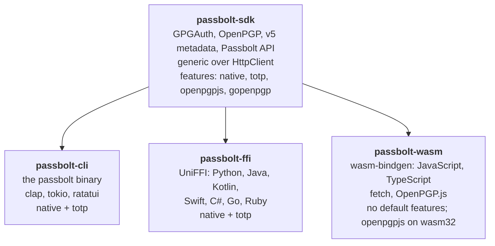
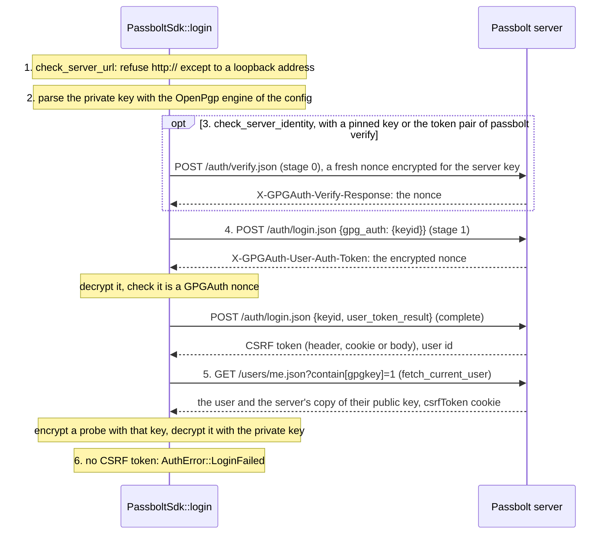
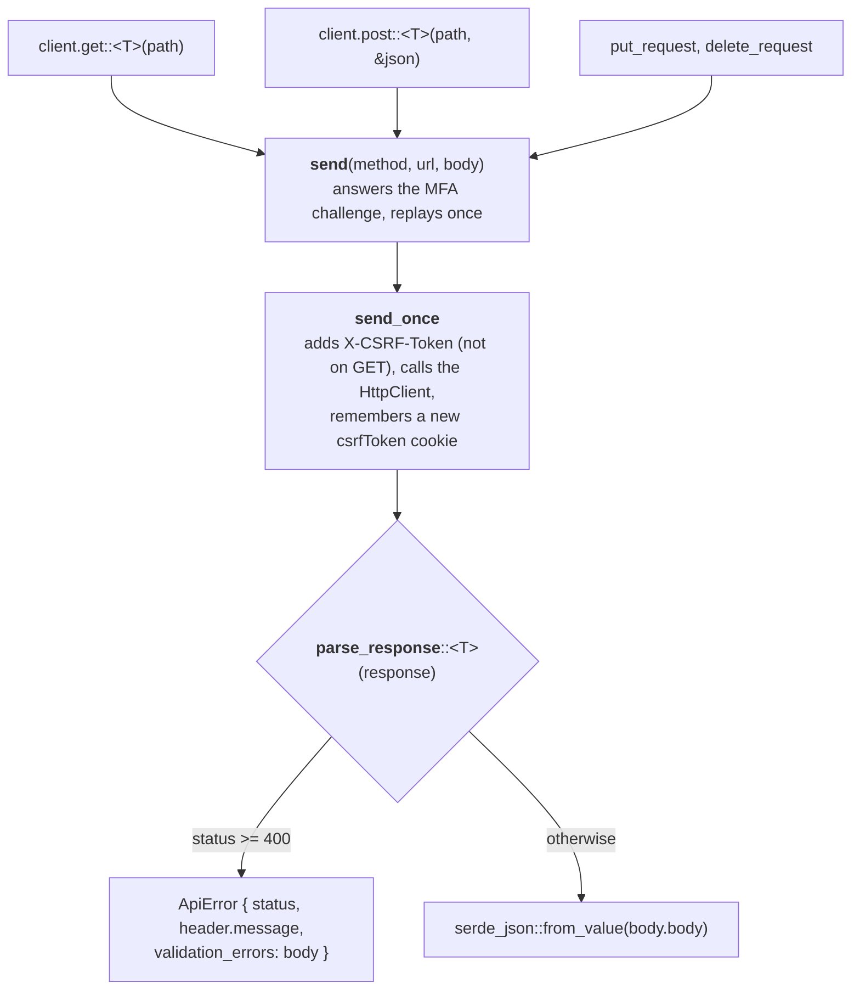

# Architecture

How the code is laid out, how a request travels, and where a new method goes.

## Crates



| Crate | Depends on | HTTP | Async runtime |
|---|---|---|---|
| `passbolt-sdk` | none of the others | any `HttpClient`; `NativeHttpClient` with `native` | the caller's |
| `passbolt-cli` | `passbolt-sdk` (`native`, `totp`) | `NativeHttpClient` | tokio |
| `passbolt-ffi` | `passbolt-sdk` (`native`, `totp`) | `NativeHttpClient` | a tokio runtime of 2 worker threads, in a `static` |
| `passbolt-wasm` | `passbolt-sdk` (no default features, `openpgpjs` on `wasm32`) | `WasmHttpClient` (`fetch`) | the JavaScript event loop |

The bindings hold no logic of their own: they convert arguments and results, and map errors.
The SDK features:

| Feature | |
|---|---|
| `native` (default) | `NativeHttpClient` (reqwest, rustls) and tokio |
| `totp` | `TotpProvider`, the TOTP codes of a base32 secret |
| `openpgpjs` | The OpenPGP.js engine |
| `gopenpgp` | The gopenpgp engine, built with Go |
| `interop` | The OpenPGP.js interoperability tests |

## The SDK

`crates/passbolt-sdk/src`:

| Module | |
|---|---|
| `client.rs` | `PassboltSdk<H: HttpClient>`: the session, the request helpers, the endpoints |
| `auth.rs` | GPGAuth login, server key fetch and server verification |
| `mfa.rs` | `MfaProvider`, `TotpProvider` |
| `http.rs`, `platform/` | The `HttpClient` trait, `NativeHttpClient` |
| `metadata.rs` | v5 metadata keys and session keys |
| `crypto/` | `OpenPgp` and its engines |
| `resource/`, `folder/`, `group/`, `user/`, `tag/`, `comment/` | Operations that take more than one request: views, create, update, share, move… |
| `types.rs` | The API structures, with the field names of the Passbolt API |
| `error.rs` | `PassboltError` and its `TransportError`, `AuthError`, `CryptoError`, `ApiError` |
| `generator/` | Passwords, passphrases, PIN codes, strength |
| `exchange/`, `transfer.rs` | CSV and KeePass import and export, ownership transfer |
| `config.rs`, `storage.rs`, `filter.rs`, `pwned.rs` | `SdkConfig`, storage, filters, Have I Been Pwned |

An endpoint that is one request is a method of `PassboltSdk` (`get_folder`, `delete_tag`…). An
operation of several requests, or one that encrypts, is a function of its module taking the
client: `resource::get::get_resource_view(&client, id)`,
`resource::list::list_resources(&client, query, …)`, `resource::share::share_resource(…)`.

### The HTTP abstraction

```rust
pub trait HttpClient: Send + Sync {
    async fn get(&self, url: &str, headers: &[(&str, &str)]) -> Result<HttpResponse, TransportError>;
    async fn post(&self, url: &str, headers: &[(&str, &str)], body: &[u8]) -> Result<HttpResponse, TransportError>;
    async fn put(&self, url: &str, headers: &[(&str, &str)], body: &[u8]) -> Result<HttpResponse, TransportError>;
    async fn delete(&self, url: &str, headers: &[(&str, &str)]) -> Result<HttpResponse, TransportError>;
    fn cookie(&self, url: &str, name: &str) -> Option<String> { None }
    async fn delete_with_body(&self, url: &str, headers: &[(&str, &str)], body: &[u8]) -> Result<HttpResponse, TransportError>;
}
```

`HttpResponse` is the status, the headers and the body bytes. The SDK builds the URLs and the
JSON bodies, and adds `X-CSRF-Token`; the backend sends them and keeps the cookies.

| | `NativeHttpClient` (`platform/native.rs`) | `WasmHttpClient` (`passbolt-wasm/src/http.rs`) |
|---|---|---|
| Transport | reqwest with rustls and the system roots | the global `fetch`, with credentials, or the `fetch` of the session |
| Cookies | reqwest's cookie jar; `cookie()` reads it | the browser keeps them; under Node, Deno and Bun the client keeps those of `Set-Cookie` and sends them back |
| CSRF token | the `csrfToken` cookie | `document.cookie`, or the `csrfTokenProvider` of the session (an extension reads the cookie with `browser.cookies`) |
| Options | `NativeHttpConfig`: TLS skip, client certificate, proxy, `resolve`, timeout | none: TLS and proxies are the browser's, or those of the `fetch` given (undici with a `dispatcher`) |
| Redirects | followed within the origin only | `fetch`'s |

The tests give the SDK a third backend, `FakePassbolt` (see [Tests](#tests)).

### Login

`PassboltSdk::login(http, &config, mfa_provider, max_attempts)`:



Each GPGAuth answer must carry the `X-GPGAuth-*` headers of its stage
(`check_gpgauth_headers`), as the browser extension checks them: a proxy answering in
Passbolt's place fails with a clear error. The SDK only decrypts a challenge that has the
format of a GPGAuth nonce (`check_auth_token_format`), so that the key never decrypts an
arbitrary message for the server. `fetch_server_key` reads `GET /auth/verify.json` and computes
the fingerprint from the key, for the user to confirm once before pinning it.

MFA is not part of the login. The server asks for it on any request once the session needs it:
`MfaRequiredCheckMiddleware` answers 403 with a redirect to `/mfa/verify/error.json`. `send`
recognizes that answer (`is_mfa_challenge`), asks the `MfaProvider` for a code, posts it to
`/mfa/verify/totp.json` (the server then sets the `passbolt_mfa` cookie), and replays the
request once. A refused code is tried again up to the attempts asked, never more than 3 in a
session: the server disables an account after 4 failed verifications. A challenge offering no
`totp` provider is `AuthError::MfaUnsupported`; no provider given is `AuthError::MfaRequired`.

### A request's path



Passbolt wraps every answer in an envelope, `{"header": {…, "message", "pagination"}, "body":
…}`: `parse_response` reads `body` into `T`, and an error takes its message from
`header.message`. `get_paginated` reads list endpoints page by page: with a `limit` it sends
`api-version=v2&limit=…&page=…`, stops when a page is short or `header.pagination.count` is
reached, and reads at most 100 pages; without a pagination header it reads one page.

The errors:

| SDK | From |
|---|---|
| `TransportError` (`Http`, `Network`, `Timeout`) | the `HttpClient` |
| `AuthError` (`LoginFailed`, `MfaRequired`, `MfaFailed`, `MfaUnsupported`, `MfaLockedOut`, `SessionExpired`, `ServerIdentityMismatch`, `KeyCrossCheckFailed`) | login, MFA |
| `CryptoError` | the OpenPGP engine |
| `ApiError { status, message, validation_errors }` | an answer with a status of 400 or more |
| `NotFound`, `Config`, `InvalidArgument`, `Json` | the SDK's own checks, a body that does not parse |

`passbolt-ffi/src/error.rs` maps them to the variants of the FFI `PassboltError` (`Transport`,
`Auth`, `Crypto`, `Api`, `NotFound`, `Config`, `InvalidArgument`, `Other`); `error_code` in
`passbolt-wasm/src/lib.rs` maps them to the JavaScript codes (`NETWORK`, `TIMEOUT`,
`MFA_REQUIRED`, `SERVER_IDENTITY_MISMATCH`, `API`…).

### v5 metadata and session keys

A v5 resource keeps its name, username, URIs and description in `metadata`, an OpenPGP message
encrypted for the user's key (`metadata_key_type` `user_key`) or for a shared metadata key
(`shared_key`, `metadata_key_id`). `metadata.rs`:

- `MetadataKeys::decrypt` decrypts the user's share of every shared metadata key not deleted
  (`metadata_private_keys[].data`), once per session (`PassboltSdk::metadata_keys`). The active
  key is the newest one neither deleted nor expired that the user holds a share of.
- `MetadataKeys::encrypt` encrypts new shared metadata for the active key, signed by the user and
  by that key; `encrypt_for_user` encrypts personal metadata for the user's key. With a pinned
  metadata key fingerprint, the client refuses to encrypt for another key.
- Session keys: decrypting with the session key of a message is much faster than with a private
  key. `SessionKeys::decrypt` reads the user's bundles (`/metadata/session-keys.json`), once per
  session; `decrypt_resource_metadata_with_session_keys` uses a known one and gives the new ones,
  which the client keeps as pending. `save_session_keys` writes them in the latest bundle and
  deletes the older ones, as the browser extension does, reading the bundle again on a 409 from
  another session.

### OpenPGP engines

`crypto/mod.rs` defines the `Engine` trait (read keys, decrypt, encrypt, sign and encrypt) and
`OpenPgp`, the engine a client reads keys with; every message operation then runs on the engine
of its key. The engines write messages as the browser extension does: for the newest valid
encryption subkey of each recipient, SEIPD v2 only when every recipient supports it, revoked and
expired keys refused.

| Engine | File | Feature |
|---|---|---|
| rpgp, in Rust (default) | `crypto/rpgp.rs` | always |
| OpenPGP.js, the library of the browser extension, in an embedded QuickJS, or in WebAssembly the OpenPGP.js of the page | `crypto/openpgpjs/` | `openpgpjs` |
| gopenpgp, built by `build.rs` with Go and linked | `crypto/gopenpgp.rs` | `gopenpgp` |

`crypto/engine_tests.rs` checks that every engine reads what the others write.

### The generator

`generator/` makes passwords (`password.rs`), passphrases of the EFF word list of the browser
extension (`passphrase.rs`, `words.txt`) and PIN codes (`pin.rs`), and measures the entropy and
strength the extension shows (`complexity.rs`). It needs no session; `PasswordPolicies` is the
`/password-policies/settings.json` of the server, read by `PassboltSdk::get_password_policies`,
which falls back to `/password-generator/settings.json` on servers before 4.2.

## The CLI

`crates/passbolt-cli/src`:

| Path | |
|---|---|
| `main.rs` | `run` handles the commands that need no session (`completion`, `gendoc`, `generate --offline`, `configure`, `verify`), then logs in, calls `dispatch`, and logs out (`session::finish`); `dispatch` matches each `Commands` variant (`Create`, `Get`, `List`, `Update`, `Delete`, `Share`, `Move`, `Exec`, `Tui`, `Generate`, `Export`, `Import`, `MigrateMetadata`) |
| `cli/root.rs` | The clap structures: `Cli`, `Commands` and their arguments |
| `cli/` | The commands with a module of their own: `configure`, `verify`, `exec`, `export`, `import`, `generate`, `gendoc` |
| `config.rs` | The settings: defaults, config file, environment variables, flags |
| `util/session.rs` | The checks before login, the HTTP client, `get_client`, `finish` (saves the session keys, logs out, warns on failure) |
| `util/output.rs`, `util/columns.rs`, `util/shapes.rs` | Tables and JSON output |
| `util/cel.rs` | `--filter` expressions |
| `util/resources.rs`, `util/password.rs`, `util/mfa.rs` | Resource fields, passphrase and TOTP prompts |
| `keepass/` | KDBX reading and writing |
| `tui/` | `passbolt tui` (feature `tui`): `app.rs` state, `ui.rs` drawing, `form.rs` editing, `clipboard.rs` |

Each command but `exec` and `tui` runs under the `--timeout` deadline (`with_deadline`).

## Tests

| Level | Location | Against |
|---|---|---|
| Unit | `#[cfg(test)] mod tests` in `crates/*/src` | single functions |
| SDK integration | `crates/passbolt-sdk/tests/it` | `FakePassbolt`, an in-memory Passbolt API |
| Transport | `crates/passbolt-sdk/tests/it/transport.rs` | wiremock servers, through `NativeHttpClient` |
| OpenPGP.js interop | `crates/passbolt-sdk/tests/it/interop.rs` (feature `interop`) | OpenPGP.js under Node (`tests/interop`) |
| FFI | `crates/passbolt-ffi/tests/session.rs` | a wiremock server answering GPGAuth |
| WASM | `crates/passbolt-wasm/tests/session.rs` | a fake `fetch` (wasm32 only) |
| CLI | `crates/passbolt-cli/tests/cli_test.rs` | the binary, offline |
| End to end | `crates/passbolt-cli/tests/e2e`, run by `scripts/e2e.sh` (feature `e2e`) | a real Passbolt server; what the CLI stores is read back with OpenPGP.js |
| Packages | `packaging/smoke/` | each installed package |

`tests/it` is one test binary (`main.rs`). `common/fake.rs` is `FakePassbolt`, an `HttpClient`
that mirrors passbolt-pro-api: login, MFA and envelopes follow its controllers and middlewares
(`AuthLoginController`, `GpgAuthenticator`, `MfaRequiredCheckMiddleware`), and the other
endpoints answer the bodies a test registers (`on`, `on_error`, `on_pages`…). It records the
requests (`requests_to`). A test must not make the fake answer what the real server cannot.
The bodies are the JSON files of `tests/fixtures/data`, in the shape of the real API, loaded by
`common/data.rs`; the keys are those of `tests/fixtures/keys`, never generated in a test.
wiremock only tests the reqwest transport. Known bugs are `#[ignore]`d tests naming their ticket.

```rust
#[tokio::test]
async fn the_password_policies_of_the_organization_are_read() {
    let fake = FakePassbolt::new();
    fake.on("GET", POLICIES, data::password_policies());
    let client = login_ada(&fake).await;

    let policies = client.get_password_policies().await.unwrap();

    assert_eq!(policies.default_generator, GeneratorType::Passphrase);
}
```

The commands to run each level are in [Development](development.md#tests).

## Adding a method end to end

The path of a new API call, from the SDK to the docs:

```text
SDK  ->  tests/it  ->  FFI client_methods!  ->  WASM  ->  binding wrappers  ->  smoke tests  ->  docs
```

1. **SDK.** A method of `PassboltSdk` in `client.rs` for one request, using `get`, `post`,
   `put_request` or `delete_request`; a function of its module for more. The structures go in
   `types.rs` with the field names of the API. It returns `Result<_, PassboltError>`.
2. **SDK tests.** In `tests/it`: register the answer on `FakePassbolt`, from a fixture of
   `tests/fixtures/data` in the shape of the real API, then check the result and the request
   sent (`requests_to`). One behaviour per test.
3. **FFI.** One entry in the `client_methods!` list of `crates/passbolt-ffi/src/lib.rs`, with a
   doc comment and an async body taking `client`: both `PassboltClient` and
   `AsyncPassboltClient` get it. Optional arguments get a default in
   `#[uniffi::method(default(...))]`. A new record goes in `types.rs` (or `resource.rs`,
   `generator.rs`) with `#[derive(uniffi::Record)]`, `#[uniffi(default = …)]` on its optional
   fields, and a `From` conversion from the SDK type. Errors convert with
   `PassboltError::from`.
4. **WASM.** A method of the session in `crates/passbolt-wasm/src/lib.rs`, with a camelCase
   `js_name` and `unchecked_return_type`; optional arguments in an options object. Declare the
   types in `src/types.d.ts`, and add a sample of a new serialized structure to
   `examples/typescript_samples.rs`, which the CI type-checks with `tsc --strict`.
5. **Binding wrappers**, when the method has optional arguments or writes a record:
   - Go: an option struct and its method in `packaging/go/options.go`, and the generated
     method in the `replaced` list of `packaging/go/rename/main.go`.
   - Ruby: the flags and optional arguments as keywords in `packaging/ruby/passbolt.rb`, and a
     new record or enum in its `RECORDS` or `ENUMS`.
   - Python: a new record or enum imported from `._ffi.passbolt_ffi` and listed in `__all__`,
     in `crates/passbolt-ffi/python/passbolt/__init__.py`.
   - Java: a builder in `packaging/java/src/com/passbolt/sdk/` for a record the caller writes.
6. **Smoke tests.** `packaging/smoke/` for a change of shape (an option struct, a builder, a
   wrapper).
7. **Docs.** Regenerate the tables of the [API reference](../sdk/api.md), add the method to the
   method table of [JavaScript](../sdk/javascript.md) and, when it matters, to the language
   pages; add a line to `CHANGELOG.md`, under `[Unreleased]`.
8. **End to end.** When the CLI uses it, a test in `crates/passbolt-cli/tests/e2e` against a
   real server.
