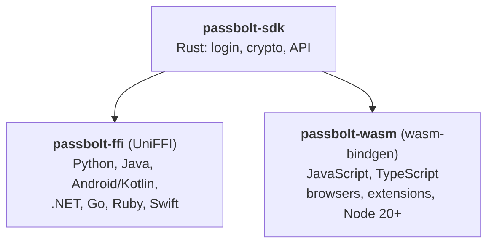

# The SDK

Call Passbolt from Rust, JavaScript, Python, Java, Kotlin, C#, Go, Ruby or Swift, with the same
login, encryption and API code in each.

The SDK is one Rust library, `passbolt-sdk`, and two thin layers that make it callable from other
languages:

The encryption, the GPGAuth login and the Passbolt API calls are the same code in every language:
only the way you call them differs.

## Choose your language

| Language | Page | Calls |
|---|---|---|
| Rust | [Rust](rust.md) | `async` |
| JavaScript / TypeScript | [JavaScript](javascript.md) | `async` (promises) |
| Python | [Python](python.md) | Blocking, or `async` (`AsyncClient`) |
| Java | [Java](java.md) | Blocking, or `CompletableFuture` (`AsyncPassboltClient`) |
| Android (Kotlin) | [Android](android.md) | Blocking, or `suspend` (`AsyncPassboltClient`) |
| .NET (C#) | [.NET](dotnet.md) | Blocking, or `Task` (`AsyncPassboltClient`) |
| Go | [Go](go.md) | Blocking |
| Ruby | [Ruby](ruby.md) | Blocking |
| Swift (iOS) | [Swift](swift.md) | Blocking, or `async` (`AsyncPassboltClient`) |

The FFI bindings have two clients with the same methods:

- `PassboltClient`, whose calls block. On mobile, call them off the main thread.
- `AsyncPassboltClient`, whose calls you await in the language's own way while the SDK's runtime
  does the network work.

Go keeps the blocking client, its goroutines being the way to wait. Ruby too, since UniFFI does
not generate async code for it yet.

## Concepts

### Session

`login` takes the server URL, the armored OpenPGP private key of the account and its passphrase,
runs GPGAuth and returns a client holding the session. `logout` ends it, and fails like any other
call when the server cannot be reached or refuses it.

### Pinning

`fetchServerKey` / `fetch_server_key` returns the server key and its fingerprint, computed from
the key. Show the fingerprint to the user once, save the key, then give it to each login
(`serverPublicKey` / `server_public_key`).

The server must then prove it holds the private key, and another server answering at the same
address is refused. The same goes for the shared metadata key (`metadataKeyFingerprint` /
`metadata_key_fingerprint`).

### Resources and views

A v5 resource keeps its name, username and URIs encrypted. The *resource views*
(`getResourceView`, `listResourceViews`, `get_resource_view`, `list_resource_views`) decrypt
them, and the secret on request, for every resource type: prefer them to the raw resources.

The FFI bindings return a `ResourceView` record. The fields every resource type shares (`name`,
`username`, `uris`, `description`, `password`, `totp`…) are typed; the others, custom fields and
icon among them, are the JSON objects `metadata_json` and `secret_json`.

### Writes

`createResource` / `create_resource` takes the fields of the resource: an object in JavaScript, a
`NewResource` record in the FFI bindings.

- `name` is required.
- Optional: `username`, `uris`, `description`, `password`, `totp`, `note`, `pin_code`,
  `folder_parent_id`, `expired`, `resource_type`, and the JSON objects `metadata_fields_json` and
  `secret_fields_json` for the other fields.
- When you leave `resource_type` out, the type follows the fields and the server's default
  version.

`updateResource` / `update_resource` takes only the fields to change (`ResourceChanges` in the FFI
bindings).

### Defaults

Optional arguments and record fields have defaults in every binding whose language has them
(Kotlin, Swift, Python, Ruby, C#).

- Go takes option structs for the calls with optional arguments, whose zero value is the default.
- Java builds the records with builders (`NewResourceBuilder`, `ResourceChangesBuilder`,
  `LoginOptionsBuilder`) and gives every method argument.

### Generating passwords

The generator works as the browser extension does:

- Passwords drawn from its character sets, passphrases of words of its EFF list, and PIN codes.
- From the password policies of the organization (`getPasswordPolicies` /
  `get_password_policies`), or from settings of your own.
- The entropy and strength the extension shows for a secret.

The generator needs no session.

### Sharing

Permission types are Passbolt's: `1` read, `7` update, `15` owner, `-1` to revoke.

### Errors

| Language | Error | What failed |
|---|---|---|
| Rust | `PassboltError` | Its variant. |
| JavaScript | An `Error` named `PassboltError` | Its `code`: `NOT_FOUND`, `API` with the HTTP `status`… |
| Python, Ruby | Subclasses of `passbolt.PassboltError` and `Passbolt::Error` | `AuthError`, `CryptoError`, `ApiError` (with the HTTP `status`), `NotFoundError`, `TransportError`, `ConfigError`, `InvalidArgumentError`. |
| Kotlin, Java, .NET | `PassboltException` | Its variant: `Auth`, `Crypto`, `Api` (with the HTTP `status`), `NotFound`, `Transport`, `Config`, `InvalidArgument`, `Other`. |
| Go, Swift | `PassboltError` | The same variants. |

Each FFI error carries the `reason` of the failure.

## What the API covers

The same operations in every language:

- Session: login (MFA with a TOTP code or secret, pinned keys, TLS options), logout, keep-alive,
  session check.
- Resources: list (search, favorites, owned), get, views, create, update, delete, share, move,
  permissions, decrypt a secret.
- Folders: list, tree, create, rename, delete (with their content), share, move, permissions.
- Users and groups: list, get, create, update, delete, delete blockers and deletion with an
  ownership transfer.
- Tags, comments, favorites, password expiry settings, metadata settings, resource types.
- Password generator: passwords, passphrases, PIN codes, password policies, secret strength.
- Have I Been Pwned check, and stateless OpenPGP helpers (`encryptMessage`, `decryptMessage`,
  `getKeyFingerprint`).

## Related

- [API reference](api.md): every client, method, function and record.
- [Upgrading](upgrading.md): the breaking changes since the 0.1.1 packages.
